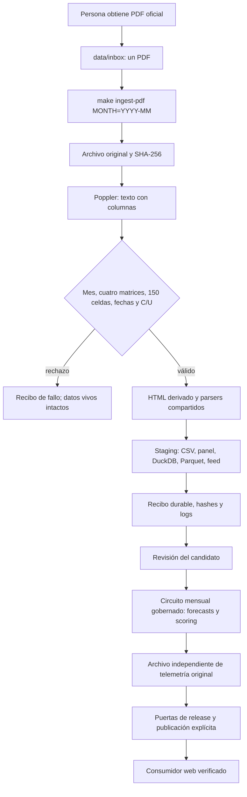

# Ingesta asistida del Visa Bulletin desde PDF

## Decisión humana y alcance

Por decisión de Javier del 24-oct-2026, la operación admitida es **depósito
humano del PDF oficial y procesamiento local automatizado**. Sustituye la
aspiración de descargar el boletín atravesando el WAF: no afirma que exista un
BrowserFetcher ni que el bloqueo del proveedor haya desaparecido.

La aceptación de A6 es esta disposición de operación asistida, más sus pruebas.
D7 deja de exigir dos meses de entrega autónoma como condición de entrega del
proyecto. Una corrida asistida se acredita con su evidencia durable; esto no
transforma el histórico 0/2 en un 2/2 ni acredita scoring por haber ingerido un PDF.

## Un comando para obtener el candidato de datos

Copiar un solo PDF oficial moderno en `data/inbox/`, conservando su nombre:

```sh
mkdir -p data/inbox
# Depositar aquí visa-bulletin-for-december-2026.pdf
make ingest-pdf MONTH=2026-12
```

Para una descarga con espacios u otra ubicación:

```sh
make ingest-pdf MONTH=2026-11 FILE='/ruta/Visa Bulletin For November 2026.pdf'
```

Se puede fijar `PY=/ruta/al/python/existente`. El intérprete debe tener las
dependencias ya declaradas del proyecto; Poppler `pdftotext` debe estar en PATH.
No se instala ningún paquete ni se crea un entorno automáticamente.

La caché histórica `data/snapshots/` debe estar restaurada previamente desde la
fuente autorizada. Si faltan meses del panel, el comando bloquea la construcción
del almacén; no fabrica procedencia. La entrada humana del mes es el PDF, no una
tabla transcrita. Los PDF sin texto, escaneados, incompletos o de otra distribución
de columnas se rechazan. No se aplica OCR ni se estiman fechas.

## Qué hace y qué conserva

1. Comprueba PDF, mes declarado, nombre cuando contiene mes, y título interno.
2. Copia los bytes originales a un archivo de ejecución nuevo; calcula SHA-256
   y extrae **esa copia**, no una ruta del usuario que pueda cambiar después.
3. Poppler extrae texto con distribución de columnas. Exige cuatro matrices,
   orden de cinco áreas, identidad de filas y **150 celdas**. Valida fechas y
   conserva `C` y `U` como estados; no son fechas predictivas.
4. Genera HTML derivado, valida K3 y utiliza los parsers compartidos del proyecto.
5. Construye un candidato aislado con los CSV históricos, el panel, el almacén
   DuckDB, Parquet, cleaning ledger y feed de boletines. Comprueba que los meses
   anteriores permanecen iguales y que el nuevo contiene 150 identidades únicas.
   Si el mes ya existía, sus celdas deben coincidir; un conflicto bloquea. La
   reejecución conserva el panel y crea un recibo de ejecución independiente.
6. Archiva original, texto, celdas, HTML, logs y hashes con estado de éxito/fallo.

La salida se imprime como última línea y queda bajo:

```text
data/pdf_intake/YYYY-MM/<sha256-del-pdf>/<run-id>/receipt.json
data/pdf_intake/YYYY-MM/<sha256-del-pdf>/<run-id>/candidate-*/data/processed/visapredict.duckdb
```

El directorio completo es evidencia local ignorada por Git: respaldarlo junto
al lote de operación. Un hash sin los archivos no sustituye ese respaldo.

## Frontera transaccional y circuito mensual

**Ningún archivo vivo del checkout es promovido por este comando.** Todos los
productores operan en staging durable. Un fallo conserva panel y almacén previos;
se conserva también el candidato fallido para diagnosticarlo. No se promete una
transacción atómica sobre múltiples archivos ni se sobrescriben snapshots S3.

Este comando NO ejecuta campaña científica, forecasts, scoring prospectivo,
promoción, EDA/FE, release-manifest, commit, push, tag, dispatch, SES o deploy.
Es el tramo **PDF → candidato de ingesta y almacén**. El procesamiento mensual
de modelado y la publicación siguen sus puertas gobernadas independientes.
No se presenta una release local como release publicada.

Para la corrida mensual, usar el circuito mensual vigente del repositorio y
archivar el scoring original con su comando existente:

```sh
python -m vp_model.tracking archive --help
```

El recibo `visapredict.pdf-intake/1` acredita la ingesta local. El recibo
`scoring-telemetry-archive/1` acredita la conservación de la telemetría del scoring.
Son autoridades distintas; un estado `local_candidate_green` no acredita
`monthly scoring ok` ni entrega automática. La revisión de resultados y la
publicación son explícitas y posteriores.



## Aceptación reproducible

```sh
VP_BULLETIN_PDF_DIR='/ruta/de/los/PDF' python -m pytest -o addopts='' tests/test_pdf_bulletin.py
```

Las dos pruebas de PDF externos se declaran saltadas si los originales no están
disponibles. La suite portable usa texto extraído de noviembre como fixture; no
contiene valores mensuales tecleados en el parser. La aceptación local ejecuta
Poppler sobre octubre y noviembre reales y compara el candidato de noviembre
contra el panel canónico. DuckDB se compara por contenido lógico; sus bytes
incluyen bitácora y no tienen obligación de ser idénticos entre construcciones.
